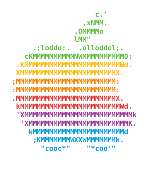

<p align="center"></p>

# Neofetch for macOS 

A command-line system information tool for macOS, written in Bash 3.2+.

This is a variation of [Neofetch](https://github.com/dylanaraps/neofetch)
by Dylan Araps, focused on macOS. It runs on the Bash that ships with macOS,
needs no extra packages and makes no network requests. On any other
operating system it exits with an error.

## Usage

```sh
./neofetch              # logo + system summary
./neofetch --stdout     # plain text
./neofetch --json       # JSON output
./neofetch uptime cpu   # only these fields
```

See `neofetch --help` or `man neofetch` for all options.

## Custom ASCII art

Replace the Apple logo with artwork saved in a multiline plain-text file:

```sh
./neofetch --ascii "$HOME/Pictures/my-art.txt"
```

To use it by default, edit `~/.config/neofetch/config.conf` (or
`$XDG_CONFIG_HOME/neofetch/config.conf` if `XDG_CONFIG_HOME` is set):

```sh
image_backend="ascii"
image_source="$HOME/Pictures/my-art.txt"
```

Artwork can contain the literal color placeholders `${c1}` through `${c6}`.
Backslashes are interpreted as escape sequences: use `\\` for a literal `\`
and only load artwork you trust.

Use at least two lines; single-line artwork currently falls back to the bundled
Apple logo. Image files such as PNG and JPEG are not supported. Artwork is omitted
with `--stdout` or `--json`.

## Install

```sh
sudo make install       # /usr/local/bin and /usr/local/share/man
sudo make uninstall     # also removes ~/.config/neofetch (config and its .bak)
```

`make uninstall` removes the per-user config of the user who ran `sudo`. If you
set a custom `XDG_CONFIG_HOME`, `sudo` drops it; remove `$XDG_CONFIG_HOME/neofetch`
by hand. A `.bak` written next to a file passed with `--config` is not removed.

## Tests

```sh
make test                  # run every case in tests/cases.sh
bash tests/run.sh disk     # run the cases whose name contains 'disk'
UPDATE=1 bash tests/run.sh # rewrite tests/golden/ after an intended output change
```

The tests run neofetch with fake system tools (`tests/fakes/`) in a clean
environment, so the expected output in `tests/golden/` is the same on every Mac.

## License

MIT. See [LICENSE.md](LICENSE.md).
